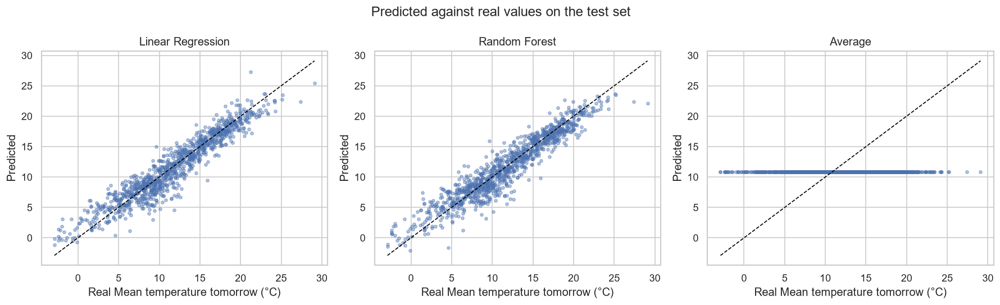

# Regression lab

Linear regression on three problems: house prices, student grades and tomorrow's temperature. How well it predicts, how it compares with simple baselines and a non-linear benchmark, and which inputs drive each prediction. Includes an interactive demo.



## Results

Test sets were not used for fitting or model choice: a random 20% for houses and students, and the last 20% of days (2022 to 2024) for the weather.

| Dataset | Model | MAE | RMSE | R² |
| --- | --- | --- | --- | --- |
| Tomorrow's temperature (5,477 days) | **Linear Regression** | **1.34 °C** | 1.74 °C | **0.900** |
| | Same as today (baseline) | 1.49 °C | 1.96 °C | 0.873 |
| | Random Forest (benchmark) | 1.37 °C | 1.77 °C | 0.896 |
| Student grades (649 students) | **Linear Regression** | **0.75** | 1.16 | **0.863** |
| | Random Forest (benchmark) | 0.73 | 1.21 | 0.850 |
| House prices (1,460 sales) | **Linear Regression** | **$21,800** | $35,800 | **0.833** |
| | Random Forest (benchmark) | $18,000 | $27,800 | 0.899 |

Always predicting the training average scores R² of about 0 on every dataset.

- **Weather**: a straight line on today's weather and the month beats the "same as today" forecast by about 10%. Today's highest temperature carries most of the signal.
- **Students**: the second-term grade explains nearly everything (permutation importance 1.35 against 0.03 for the first-term grade). Study time and absences add little once recent marks are known.
- **Houses**: living area, overall quality and neighbourhood matter most. Prices curve upward with size and quality, which a straight line misses and a forest catches, hence the gap.

Full tables and figures: [docs/results.md](docs/results.md). How it was done: [docs/methodology.md](docs/methodology.md).

## Run it

Needs Python 3.14+ and [uv](https://docs.astral.sh/uv/).

```bash
uv sync
uv run python main.py
uv run streamlit run app.py
```

`main.py` downloads the three datasets once into `data/`, then writes figures and tables to `outputs/`, models to `models/` and the tables to `docs/results.md`. Outputs and models are committed, so the demo works without running it.

## The demo

- **Overview**: what linear regression is, how it is measured and what was found.
- **Predict**: start from typical values or a real test example, change the inputs and see the prediction. For Linear Regression, a chart shows how far each input moves the prediction from the average.
- **Results**: model comparison, weights, permutation importance, the largest errors and the data checks.

## Layout

```
regression_lab/   spec.py (datasets and models), data.py (downloads), explain.py (per-input contributions), report.py
pxlab/            shared engine (vendored): data checks, pipelines, tuning, evaluation, app helpers
main.py           the full study
app.py            the Streamlit demo
docs/             methodology, results, deploy
```

## Data

- **House prices**: Ames, Iowa housing data, De Cock (2011), *Journal of Statistics Education* 19(3), via [OpenML 42165](https://www.openml.org/d/42165).
- **Student grades**: Cortez and Silva (2008), [UCI Student Performance](https://archive.ics.uci.edu/dataset/320/student+performance), CC BY 4.0. The Portuguese-course file.
- **Weather**: London (51.51 N, 0.13 W), 2010 to 2024, from the [Open-Meteo historical weather API](https://open-meteo.com/en/docs/historical-weather-api) (ERA5 reanalysis), CC BY 4.0.

## License

MIT
