# Results

Produced by `python main.py`. Test sets are 20% of each dataset (the most recent days for the weather) and were not used for fitting or model choice.

## House prices: Models

### Test-set errors

| Model | Role | CV r2 | MAE | RMSE | R² |
| --- | --- | --- | --- | --- | --- |
| Linear Regression | Main | 0.784 | 21797.428 | 35827.971 | 0.833 |
| Random Forest | Benchmark beyond the course | 0.824 | 17954.346 | 27833.002 | 0.899 |
| Average | Baseline | -0.002 | 62575.926 | 87619.035 | -0.001 |

## House prices: Key findings

### What the in-depth analysis found

| Finding |
| --- |
| Random Forest scores R² 0.899 on the test set (95% interval 0.862 to 0.927); the baseline that ignores the inputs (Average) scores -0.001. |
| Random Forest against Linear Regression on error sizes (Wilcoxon signed-rank): real difference (p = 0.000). |
| Random Forest against Average on error sizes (Wilcoxon signed-rank): real difference (p = 0.000). |
| Linear Regression generalises well: training and validation r2 are close (+0.027); validation has levelled off, so more data alone would help little. |
| Random Forest overfits: training r2 0.975 against validation 0.824; validation has levelled off, so more data alone would help little. |
| Random Forest is most biased for Sale price ($) 234,800 to 755,000: it predicts too low by 17,625 on average there (MAE 35,204). |

## House prices: Reliability

Bootstrap 95% intervals: how much each test score could move with a different test sample.

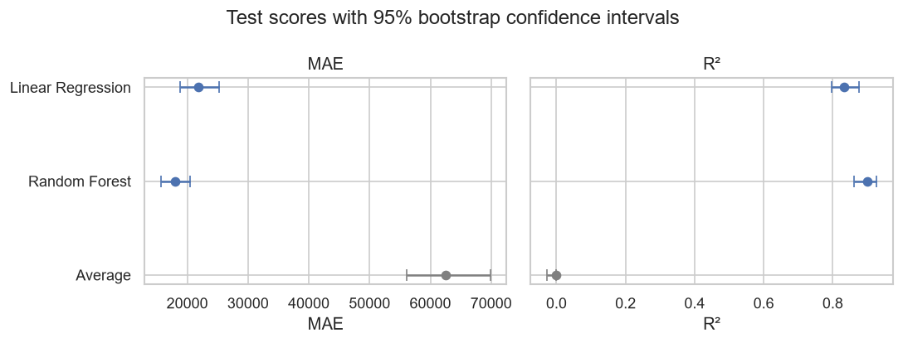

### Confidence intervals

| Model | Score | Test value | Low | High |
| --- | --- | --- | --- | --- |
| Linear Regression | MAE | 21797.4277 | 18878.8653 | 25189.5535 |
| Linear Regression | R² | 0.8326 | 0.7961 | 0.876 |
| Random Forest | MAE | 17954.3457 | 15639.7061 | 20506.5735 |
| Random Forest | R² | 0.899 | 0.8619 | 0.9267 |
| Average | MAE | 62575.9265 | 56129.2672 | 69846.5626 |
| Average | R² | -0.0009 | -0.027 | -0.0 |

### Is the best model really better? (paired tests)

| Best model | Compared with | Best is better on | Other is better on | Test | p-value | Verdict |
| --- | --- | --- | --- | --- | --- | --- |
| Random Forest | Linear Regression | 176 | 116 | Wilcoxon signed-rank | 0.0002 | Real difference |
| Random Forest | Average | 252 | 40 | Wilcoxon signed-rank | 0.0 | Real difference |

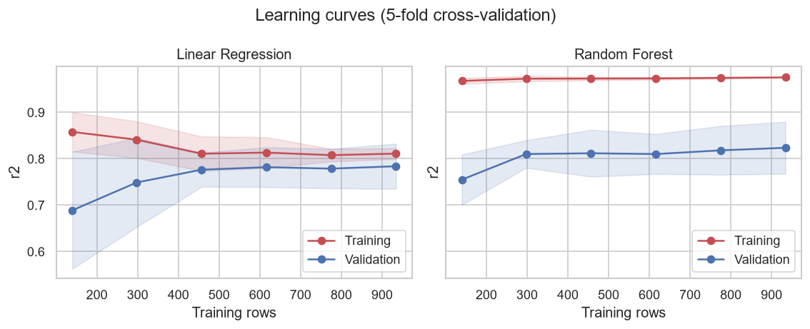

### Learning curves

| Model | Training rows | Training score | Validation score |
| --- | --- | --- | --- |
| Linear Regression | 140 | 0.8579 | 0.689 |
| Linear Regression | 298 | 0.8411 | 0.7489 |
| Linear Regression | 457 | 0.8109 | 0.7764 |
| Linear Regression | 616 | 0.8133 | 0.7818 |
| Linear Regression | 775 | 0.8078 | 0.7787 |
| Linear Regression | 934 | 0.8111 | 0.7839 |
| Random Forest | 140 | 0.9678 | 0.7551 |
| Random Forest | 298 | 0.9726 | 0.8102 |
| Random Forest | 457 | 0.9729 | 0.8119 |
| Random Forest | 616 | 0.9732 | 0.8102 |
| Random Forest | 775 | 0.9743 | 0.8181 |
| Random Forest | 934 | 0.9754 | 0.8236 |

## House prices: Error analysis

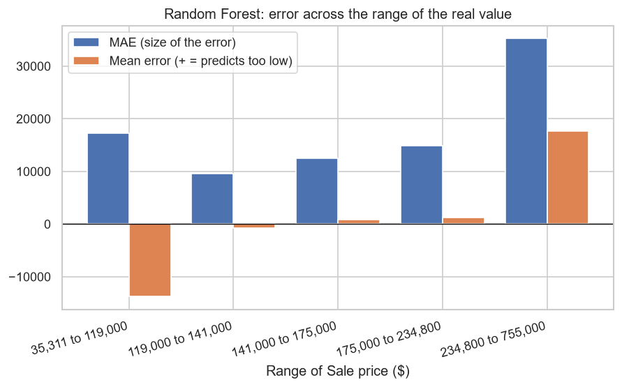

### Error across the range of the real value

| Range of Sale price ($) | Cases | MAE | Mean error |
| --- | --- | --- | --- |
| 35,311 to 119,000 | 60 | 17300.9792 | -13754.3033 |
| 119,000 to 141,000 | 58 | 9547.2157 | -722.7754 |
| 141,000 to 175,000 | 58 | 12530.4111 | 859.1053 |
| 175,000 to 234,800 | 57 | 14860.5585 | 1288.143 |
| 234,800 to 755,000 | 59 | 35204.3392 | 17625.4497 |

### Error per category

| Input | Value | Cases | MAE | Mean error |
| --- | --- | --- | --- | --- |
| Neighbourhood | NAmes | 44 | 9021.7787 | 1482.5572 |
| Neighbourhood | CollgCr | 35 | 13716.7105 | -1225.0278 |
| Neighbourhood | OldTown | 22 | 13220.5554 | -8006.9306 |
| Neighbourhood | Somerst | 17 | 14786.8682 | 2789.6161 |
| Neighbourhood | Sawyer | 16 | 13183.4881 | -6731.8019 |
| Neighbourhood | NridgHt | 16 | 39804.4765 | 18024.3169 |
| Neighbourhood | SawyerW | 15 | 19127.904 | 5754.888 |
| Neighbourhood | Gilbert | 14 | 12785.919 | -2429.9324 |

## House prices: Weights

### Linear Regression weights (per standard deviation of each input)

| Input | Weight |
| --- | --- |
| Neighbourhood = StoneBr | 49018.3592 |
| Neighbourhood = NridgHt | 46901.8086 |
| Neighbourhood = NoRidge | 45031.8984 |
| Neighbourhood = Blueste | -36585.5723 |
| Neighbourhood = BrDale | -35493.5837 |
| Neighbourhood = Veenker | 34544.0095 |
| Living area (sq ft) | 26056.9637 |
| Neighbourhood = Crawfor | 23283.7129 |
| Neighbourhood = Blmngtn | -23119.6238 |
| Overall quality (1 to 10) | 21739.2745 |
| Neighbourhood = NPkVill | -20173.2648 |
| Neighbourhood = MeadowV | -15069.7353 |
| Neighbourhood = OldTown | -14823.445 |
| Neighbourhood = Edwards | -14010.5261 |
| Neighbourhood = ClearCr | 13533.6405 |
| Neighbourhood = Mitchel | -11201.2684 |
| Neighbourhood = NWAmes | -11178.8384 |
| Age when sold (years) | -9500.8245 |
| Neighbourhood = SawyerW | -9136.4839 |
| Garage size (cars) | 8998.1916 |
| Neighbourhood = IDOTRR | -8781.0446 |
| Neighbourhood = Gilbert | -8682.4058 |
| Basement area (sq ft) | 7061.4662 |
| Neighbourhood = SWISU | -6259.3562 |
| Lot area (sq ft) | 6183.7876 |
| Neighbourhood = NAmes | -5579.4752 |
| Neighbourhood = Timber | 5193.2373 |
| Neighbourhood = Somerst | 5001.8257 |
| Bedrooms | -3520.0477 |
| Neighbourhood = Sawyer | -2859.387 |
| Neighbourhood = BrkSide | 1268.0496 |
| Neighbourhood = CollgCr | -822.5312 |
| Full bathrooms | -320.3445 |

## House prices: Which inputs matter

### Permutation importance (drop in R² when the input is shuffled)

|  | Linear Regression | Random Forest |
| --- | --- | --- |
| Living area (sq ft) | 0.2353 | 0.1883 |
| Overall quality (1 to 10) | 0.1788 | 0.5704 |
| Neighbourhood | 0.1143 | 0.0137 |
| Garage size (cars) | 0.035 | 0.0371 |
| Basement area (sq ft) | 0.0304 | 0.0931 |
| Age when sold (years) | 0.0261 | 0.0312 |
| Lot area (sq ft) | 0.0077 | 0.0231 |
| Bedrooms | 0.0045 | 0.006 |
| Full bathrooms | -0.0003 | 0.0076 |

## House prices: Errors

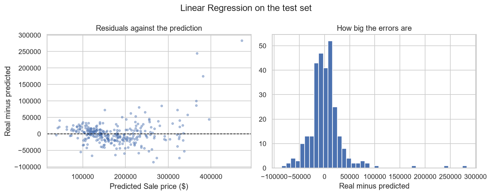

### Largest Linear Regression errors on the test set

| Living area (sq ft) | Basement area (sq ft) | Lot area (sq ft) | Bedrooms | Full bathrooms | Garage size (cars) | Overall quality (1 to 10) | Age when sold (years) | Neighbourhood | Real | Predicted | Error |
| --- | --- | --- | --- | --- | --- | --- | --- | --- | --- | --- | --- |
| 4316 | 2444 | 21535 | 4 | 3 | 3 | 10 | 13 | NoRidge | 755000.0 | 471687.8 | 283312.2 |
| 2364 | 2330 | 12919 | 2 | 2 | 3 | 9 | 1 | NridgHt | 611657.0 | 366896.65 | 244760.35 |
| 2868 | 1992 | 16056 | 4 | 3 | 3 | 9 | 1 | StoneBr | 556581.0 | 381114.14 | 175466.86 |
| 2076 | 2076 | 13891 | 2 | 2 | 3 | 10 | 0 | NridgHt | 465000.0 | 365280.05 | 99719.95 |
| 2296 | 1722 | 13478 | 3 | 2 | 3 | 10 | 1 | NridgHt | 451950.0 | 365618.24 | 86331.76 |
| 2028 | 1868 | 11443 | 2 | 2 | 3 | 8 | 1 | Timber | 369900.0 | 284328.92 | 85571.08 |
| 1337 | 1337 | 5395 | 2 | 2 | 2 | 8 | 15 | StoneBr | 180000.0 | 265320.03 | -85320.03 |
| 1954 | 798 | 15660 | 3 | 1 | 2 | 7 | 69 | Crawfor | 311500.0 | 231107.3 | 80392.7 |
| 1973 | 1935 | 14226 | 3 | 2 | 3 | 8 | 1 | NridgHt | 395000.0 | 321602.45 | 73397.55 |
| 2008 | 896 | 7800 | 3 | 3 | 1 | 5 | 58 | Edwards | 225000.0 | 151814.99 | 73185.01 |
| 2042 | 2042 | 12704 | 3 | 2 | 3 | 8 | 1 | NridgHt | 253293.0 | 325872.45 | -72579.45 |
| 2515 | 2035 | 32668 | 4 | 3 | 2 | 6 | 50 | Crawfor | 200624.0 | 273034.79 | -72410.79 |
| 1726 | 1726 | 9416 | 3 | 2 | 3 | 7 | 0 | Somerst | 311872.0 | 245715.68 | 66156.32 |
| 1044 | 540 | 8712 | 2 | 1 | 2 | 5 | 58 | IDOTRR | 55993.0 | 121653.62 | -65660.62 |
| 1902 | 0 | 8930 | 4 | 2 | 2 | 6 | 32 | Sawyer | 112000.0 | 176307.41 | -64307.41 |
| 1644 | 1518 | 12800 | 2 | 2 | 2 | 7 | 20 | SawyerW | 275000.0 | 212134.29 | 62865.71 |
| 1709 | 970 | 2522 | 3 | 2 | 2 | 7 | 2 | Edwards | 137500.0 | 196993.5 | -59493.5 |
| 1739 | 970 | 2645 | 3 | 2 | 2 | 8 | 10 | Somerst | 172500.0 | 230993.72 | -58493.72 |
| 2794 | 1462 | 15138 | 4 | 2 | 3 | 8 | 14 | NoRidge | 403000.0 | 345084.07 | 57915.93 |
| 1317 | 649 | 8500 | 3 | 1 | 1 | 4 | 88 | IDOTRR | 40000.0 | 95121.78 | -55121.78 |

## House prices: Data

### Data quality

| Column | Type | Missing | Distinct values |
| --- | --- | --- | --- |
| GrLivArea | numeric | 0 | 861 |
| TotalBsmtSF | numeric | 0 | 721 |
| LotArea | numeric | 0 | 1073 |
| BedroomAbvGr | numeric | 0 | 8 |
| FullBath | numeric | 0 | 4 |
| GarageCars | numeric | 0 | 5 |
| OverallQual | numeric | 0 | 10 |
| Age | numeric | 0 | 122 |
| Neighborhood | category | 0 | 25 |
| SalePrice | target | 0 | 663 |

## Student grades: Models

### Test-set errors

| Model | Role | CV r2 | MAE | RMSE | R² |
| --- | --- | --- | --- | --- | --- |
| Linear Regression | Main | 0.841 | 0.746 | 1.155 | 0.863 |
| Random Forest | Benchmark beyond the course | 0.846 | 0.731 | 1.209 | 0.85 |
| Average | Baseline | -0.02 | 2.395 | 3.173 | -0.032 |

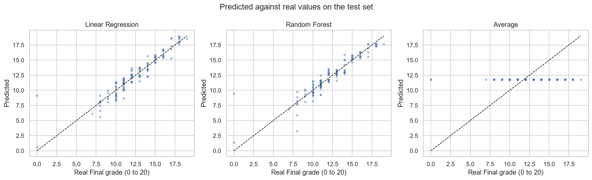

## Student grades: Key findings

### What the in-depth analysis found

| Finding |
| --- |
| Random Forest scores R² 0.850 on the test set (95% interval 0.723 to 0.939); the baseline that ignores the inputs (Average) scores -0.032. |
| Random Forest against Linear Regression on error sizes (Wilcoxon signed-rank): could be chance (p = 0.232). |
| Random Forest against Average on error sizes (Wilcoxon signed-rank): real difference (p = 0.000). |
| Linear Regression generalises well: training and validation r2 are close (+0.006); validation has levelled off, so more data alone would help little. |
| Random Forest generalises well: training and validation r2 are close (+0.044); validation is still rising, so more data would likely help. |
| Random Forest is most biased for Final grade (0 to 20) 15 to 19: it predicts too low by 0.309 on average there (MAE 0.534). |

## Student grades: Reliability

Bootstrap 95% intervals: how much each test score could move with a different test sample.

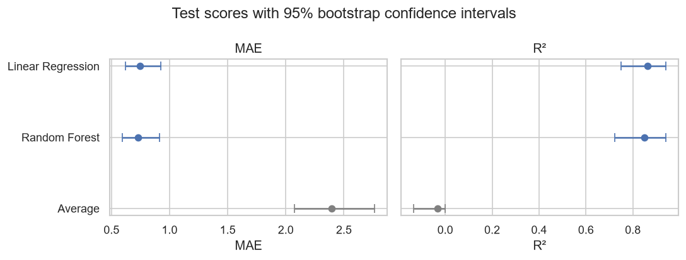

### Confidence intervals

| Model | Score | Test value | Low | High |
| --- | --- | --- | --- | --- |
| Linear Regression | MAE | 0.7462 | 0.6179 | 0.9219 |
| Linear Regression | R² | 0.8633 | 0.7492 | 0.9405 |
| Random Forest | MAE | 0.7311 | 0.5924 | 0.916 |
| Random Forest | R² | 0.8502 | 0.7235 | 0.9393 |
| Average | MAE | 2.3946 | 2.0747 | 2.764 |
| Average | R² | -0.0322 | -0.1357 | -0.0005 |

### Is the best model really better? (paired tests)

| Best model | Compared with | Best is better on | Other is better on | Test | p-value | Verdict |
| --- | --- | --- | --- | --- | --- | --- |
| Random Forest | Linear Regression | 72 | 58 | Wilcoxon signed-rank | 0.2323 | Could be chance |
| Random Forest | Average | 109 | 21 | Wilcoxon signed-rank | 0.0 | Real difference |

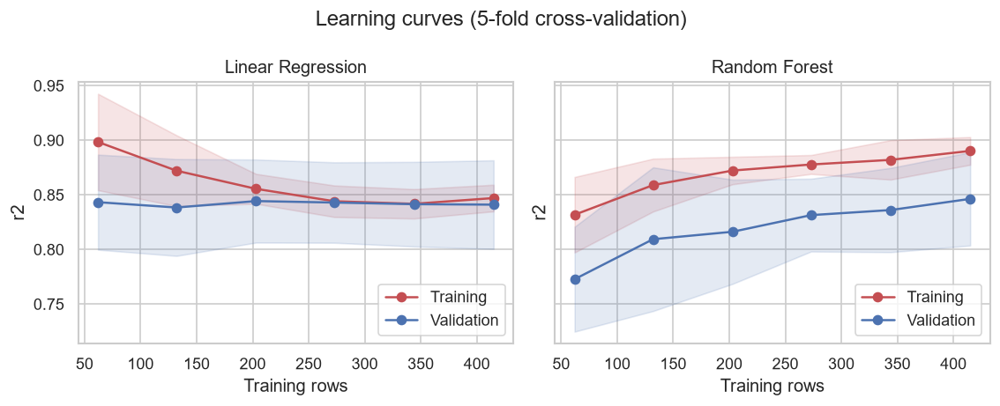

### Learning curves

| Model | Training rows | Training score | Validation score |
| --- | --- | --- | --- |
| Linear Regression | 62 | 0.8983 | 0.8432 |
| Linear Regression | 132 | 0.8721 | 0.8383 |
| Linear Regression | 203 | 0.8554 | 0.8442 |
| Linear Regression | 273 | 0.8441 | 0.8429 |
| Linear Regression | 344 | 0.8417 | 0.8414 |
| Linear Regression | 415 | 0.847 | 0.841 |
| Random Forest | 62 | 0.8317 | 0.7727 |
| Random Forest | 132 | 0.8589 | 0.8093 |
| Random Forest | 203 | 0.8722 | 0.8161 |
| Random Forest | 273 | 0.8777 | 0.8314 |
| Random Forest | 344 | 0.882 | 0.836 |
| Random Forest | 415 | 0.8902 | 0.8463 |

## Student grades: Error analysis

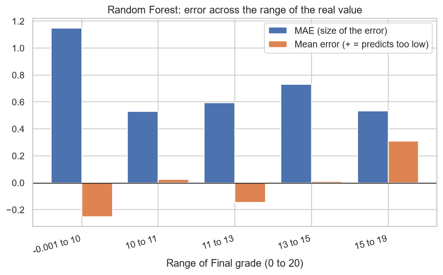

### Error across the range of the real value

| Range of Final grade (0 to 20) | Cases | MAE | Mean error |
| --- | --- | --- | --- |
| -0.001 to 10 | 32 | 1.1493 | -0.2537 |
| 10 to 11 | 25 | 0.5282 | 0.0237 |
| 11 to 13 | 29 | 0.5953 | -0.1467 |
| 13 to 15 | 22 | 0.7293 | 0.0091 |
| 15 to 19 | 22 | 0.5339 | 0.3093 |

## Student grades: Weights

### Linear Regression weights (per standard deviation of each input)

| Input | Weight |
| --- | --- |
| Second-term grade (0 to 20) | 2.5113 |
| First-term grade (0 to 20) | 0.4844 |
| Absences | 0.1178 |
| Weekly study time (band) | 0.0927 |
| Past class failures | -0.0908 |

## Student grades: Which inputs matter

### Permutation importance (drop in R² when the input is shuffled)

|  | Linear Regression | Random Forest |
| --- | --- | --- |
| Second-term grade (0 to 20) | 1.3463 | 1.6203 |
| First-term grade (0 to 20) | 0.0283 | -0.0001 |
| Absences | 0.0028 | 0.0497 |
| Past class failures | 0.0024 | 0.012 |
| Weekly study time (band) | 0.0005 | -0.0004 |

## Student grades: Errors

### Largest Linear Regression errors on the test set

| First-term grade (0 to 20) | Second-term grade (0 to 20) | Weekly study time (band) | Absences | Past class failures | Real | Predicted | Error |
| --- | --- | --- | --- | --- | --- | --- | --- |
| 11 | 9 | 1 | 0 | 2 | 0 | 9.13 | -9.13 |
| 8 | 5 | 2 | 8 | 1 | 8 | 5.57 | 2.43 |
| 6 | 9 | 2 | 0 | 0 | 11 | 8.65 | 2.35 |
| 11 | 12 | 2 | 2 | 0 | 14 | 12.22 | 1.78 |
| 8 | 8 | 2 | 4 | 0 | 10 | 8.24 | 1.76 |
| 14 | 15 | 1 | 2 | 0 | 17 | 15.27 | 1.73 |
| 14 | 13 | 1 | 8 | 0 | 12 | 13.68 | -1.68 |
| 15 | 15 | 3 | 2 | 0 | 14 | 15.68 | -1.68 |
| 11 | 12 | 3 | 2 | 0 | 14 | 12.34 | 1.66 |
| 17 | 18 | 3 | 0 | 0 | 17 | 18.61 | -1.61 |
| 7 | 9 | 2 | 2 | 3 | 10 | 8.42 | 1.58 |
| 18 | 18 | 1 | 0 | 0 | 17 | 18.56 | -1.56 |
| 12 | 11 | 2 | 0 | 0 | 13 | 11.48 | 1.52 |
| 11 | 11 | 3 | 0 | 0 | 10 | 11.42 | -1.42 |
| 9 | 9 | 1 | 0 | 3 | 10 | 8.62 | 1.38 |
| 12 | 13 | 2 | 6 | 0 | 12 | 13.38 | -1.38 |
| 7 | 7 | 2 | 0 | 3 | 8 | 6.62 | 1.38 |
| 12 | 13 | 2 | 2 | 0 | 12 | 13.28 | -1.28 |
| 10 | 11 | 3 | 2 | 0 | 10 | 11.28 | -1.28 |
| 9 | 11 | 2 | 11 | 0 | 10 | 11.22 | -1.22 |

## Student grades: Data

### Data quality

| Column | Type | Missing | Distinct values |
| --- | --- | --- | --- |
| G1 | numeric | 0 | 17 |
| G2 | numeric | 0 | 16 |
| studytime | numeric | 0 | 4 |
| absences | numeric | 0 | 24 |
| failures | numeric | 0 | 4 |
| G3 | target | 0 | 17 |

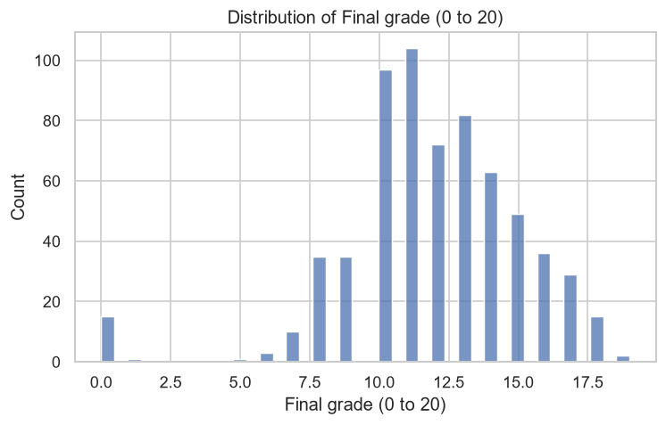

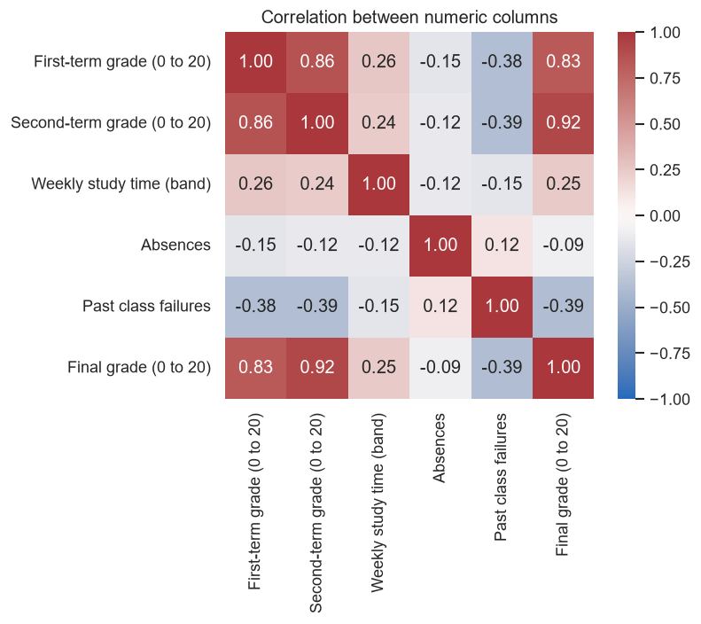

## Tomorrow's temperature: Models

### Test-set errors

| Model | Role | CV r2 | MAE | RMSE | R² |
| --- | --- | --- | --- | --- | --- |
| Linear Regression | Main | 0.903 | 1.339 | 1.744 | 0.9 |
| Random Forest | Benchmark beyond the course | 0.897 | 1.365 | 1.774 | 0.896 |
| Average | Baseline | -0.015 | 4.564 | 5.592 | -0.029 |
| Same as today | Baseline | nan | 1.489 | 1.963 | 0.873 |

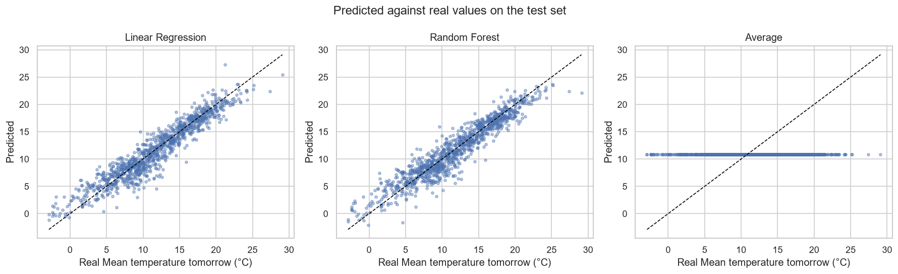

## Tomorrow's temperature: Key findings

### What the in-depth analysis found

| Finding |
| --- |
| Linear Regression scores R² 0.900 on the test set (95% interval 0.888 to 0.912); the baseline that ignores the inputs (Average) scores -0.029. |
| Linear Regression against Random Forest on error sizes (Wilcoxon signed-rank): could be chance (p = 0.127). |
| Linear Regression against Average on error sizes (Wilcoxon signed-rank): real difference (p = 0.000). |
| Linear Regression generalises well: training and validation r2 are close (+0.020); validation has levelled off, so more data alone would help little. |
| Random Forest generalises well: training and validation r2 are close (+0.074); validation has levelled off, so more data alone would help little. |
| Linear Regression is most biased for Mean temperature tomorrow (°C) -2.9 to 7.1: it predicts too high by 1.09 on average there (MAE 1.59). |

## Tomorrow's temperature: Reliability

Bootstrap 95% intervals: how much each test score could move with a different test sample.

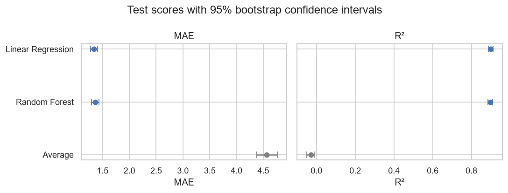

### Confidence intervals

| Model | Score | Test value | Low | High |
| --- | --- | --- | --- | --- |
| Linear Regression | MAE | 1.3391 | 1.2749 | 1.4048 |
| Linear Regression | R² | 0.8999 | 0.8883 | 0.9116 |
| Random Forest | MAE | 1.3651 | 1.2969 | 1.4295 |
| Random Forest | R² | 0.8964 | 0.8841 | 0.9084 |
| Average | MAE | 4.5637 | 4.3698 | 4.7624 |
| Average | R² | -0.0291 | -0.0534 | -0.0129 |

### Is the best model really better? (paired tests)

| Best model | Compared with | Best is better on | Other is better on | Test | p-value | Verdict |
| --- | --- | --- | --- | --- | --- | --- |
| Linear Regression | Random Forest | 560 | 536 | Wilcoxon signed-rank | 0.1273 | Could be chance |
| Linear Regression | Average | 898 | 198 | Wilcoxon signed-rank | 0.0 | Real difference |

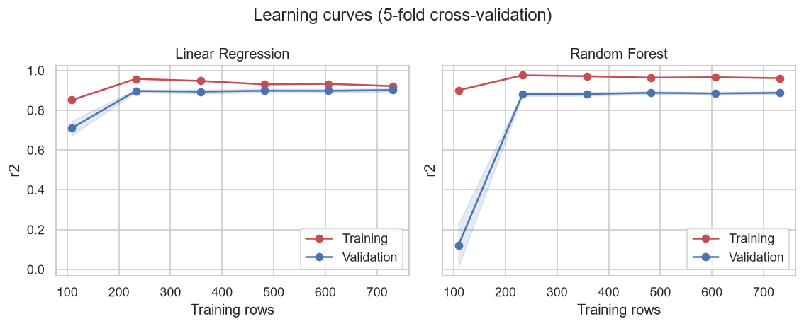

### Learning curves

| Model | Training rows | Training score | Validation score |
| --- | --- | --- | --- |
| Linear Regression | 109 | 0.8511 | 0.7107 |
| Linear Regression | 233 | 0.9577 | 0.8967 |
| Linear Regression | 358 | 0.9472 | 0.8935 |
| Linear Regression | 482 | 0.9302 | 0.8979 |
| Linear Regression | 606 | 0.9328 | 0.8974 |
| Linear Regression | 731 | 0.9212 | 0.9013 |
| Random Forest | 109 | 0.9006 | 0.1215 |
| Random Forest | 233 | 0.9756 | 0.8803 |
| Random Forest | 358 | 0.9711 | 0.8813 |
| Random Forest | 482 | 0.9636 | 0.8874 |
| Random Forest | 606 | 0.9659 | 0.8841 |
| Random Forest | 731 | 0.961 | 0.8873 |

## Tomorrow's temperature: Error analysis

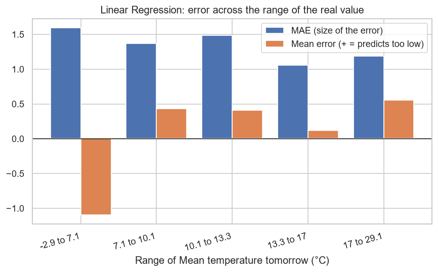

### Error across the range of the real value

| Range of Mean temperature tomorrow (°C) | Cases | MAE | Mean error |
| --- | --- | --- | --- |
| -2.9 to 7.1 | 223 | 1.5939 | -1.0922 |
| 7.1 to 10.1 | 221 | 1.3689 | 0.4322 |
| 10.1 to 13.3 | 215 | 1.4813 | 0.4124 |
| 13.3 to 17 | 221 | 1.0596 | 0.1165 |
| 17 to 29.1 | 216 | 1.1901 | 0.5581 |

### Error per category

| Input | Value | Cases | MAE | Mean error |
| --- | --- | --- | --- | --- |
| Month | 12 | 93 | 1.6924 | 0.2547 |
| Month | 1 | 93 | 1.7011 | -0.2354 |
| Month | 3 | 93 | 1.4328 | 0.351 |
| Month | 5 | 93 | 1.0213 | -0.2046 |
| Month | 7 | 93 | 1.0571 | 0.0955 |
| Month | 8 | 93 | 1.1462 | 0.1988 |
| Month | 10 | 93 | 1.4944 | -0.0262 |
| Month | 4 | 90 | 1.315 | 0.0804 |

## Tomorrow's temperature: Weights

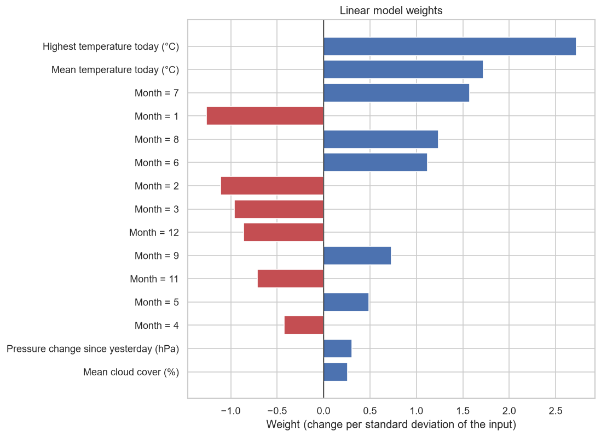

### Linear Regression weights (per standard deviation of each input)

| Input | Weight |
| --- | --- |
| Highest temperature today (°C) | 2.7232 |
| Mean temperature today (°C) | 1.7222 |
| Month = 7 | 1.5741 |
| Month = 1 | -1.2645 |
| Month = 8 | 1.2389 |
| Month = 6 | 1.1222 |
| Month = 2 | -1.1073 |
| Month = 3 | -0.9594 |
| Month = 12 | -0.8635 |
| Month = 9 | 0.7287 |
| Month = 11 | -0.7146 |
| Month = 5 | 0.4879 |
| Month = 4 | -0.4232 |
| Pressure change since yesterday (hPa) | 0.304 |
| Mean cloud cover (%) | 0.2596 |
| Lowest temperature today (°C) | 0.197 |
| Mean humidity (%) | 0.1956 |
| Month = 10 | 0.1806 |
| Mean sea-level pressure (hPa) | 0.1474 |
| Rain and snow (mm) | -0.0774 |
| Sunshine energy (MJ/m²) | -0.0532 |
| Strongest wind (km/h) | 0.026 |

## Tomorrow's temperature: Which inputs matter

### Permutation importance (drop in R² when the input is shuffled)

|  | Linear Regression | Random Forest |
| --- | --- | --- |
| Highest temperature today (°C) | 0.4904 | 0.1312 |
| Mean temperature today (°C) | 0.1882 | 1.146 |
| Month | 0.0606 | 0.0024 |
| Pressure change since yesterday (hPa) | 0.0065 | 0.0064 |
| Mean cloud cover (%) | 0.0054 | 0.0033 |
| Mean humidity (%) | 0.0021 | -0.0008 |
| Lowest temperature today (°C) | 0.0018 | 0.0056 |
| Mean sea-level pressure (hPa) | 0.0016 | 0.0047 |
| Strongest wind (km/h) | 0.0003 | 0.0022 |
| Rain and snow (mm) | 0.0003 | 0.001 |
| Sunshine energy (MJ/m²) | 0.0002 | 0.0019 |

## Tomorrow's temperature: Errors

### Largest Linear Regression errors on the test set

| Mean temperature today (°C) | Highest temperature today (°C) | Lowest temperature today (°C) | Mean humidity (%) | Rain and snow (mm) | Strongest wind (km/h) | Mean sea-level pressure (hPa) | Pressure change since yesterday (hPa) | Mean cloud cover (%) | Sunshine energy (MJ/m²) | Month | Real | Predicted | Error |
| --- | --- | --- | --- | --- | --- | --- | --- | --- | --- | --- | --- | --- | --- |
| 2.1 | 8.7 | -3.7 | 92 | 10.4 | 30.6 | 1016.5 | -5.9 | 100 | 0.55 | 12 | 11.8 | 4.57 | 7.23 |
| 8.7 | 14.9 | 1.2 | 86 | 11.6 | 32.2 | 1003.7 | -4.2 | 100 | 0.54 | 11 | 15.9 | 9.45 | 6.45 |
| 2.6 | 5.2 | -1.0 | 73 | 0.0 | 26.9 | 1023.2 | 1.2 | 93 | 3.15 | 1 | 9.2 | 3.03 | 6.17 |
| 29.1 | 38.0 | 19.9 | 40 | 0.9 | 22.5 | 1012.0 | -7.2 | 31 | 26.74 | 7 | 21.2 | 27.29 | -6.09 |
| 6.6 | 9.6 | 2.0 | 90 | 7.1 | 34.5 | 1006.4 | 7.3 | 79 | 1.63 | 2 | 12.6 | 6.65 | 5.95 |
| 16.8 | 20.6 | 9.5 | 81 | 13.3 | 38.3 | 1001.9 | -9.8 | 77 | 6.26 | 10 | 9.6 | 15.0 | -5.4 |
| 7.0 | 9.2 | 3.3 | 93 | 2.0 | 12.4 | 1003.9 | -3.0 | 99 | 1.74 | 11 | 12.2 | 6.82 | 5.38 |
| 2.7 | 7.9 | -3.6 | 77 | 1.1 | 16.7 | 1009.7 | 12.7 | 87 | 8.69 | 3 | 10.1 | 4.76 | 5.34 |
| 1.4 | 2.5 | 0.2 | 96 | 13.2 | 23.3 | 991.7 | -8.4 | 100 | 1.86 | 3 | 6.4 | 1.17 | 5.23 |
| 6.2 | 10.3 | 3.4 | 89 | 1.3 | 14.6 | 1019.8 | 5.9 | 55 | 5.54 | 11 | 12.3 | 7.16 | 5.14 |
| 7.2 | 9.2 | 4.1 | 78 | 1.9 | 25.8 | 1018.8 | -6.4 | 100 | 3.79 | 3 | 11.5 | 6.43 | 5.07 |
| 22.7 | 29.4 | 14.8 | 49 | 0.0 | 15.1 | 1024.9 | 0.0 | 63 | 25.82 | 7 | 27.4 | 22.37 | 5.03 |
| 6.3 | 9.6 | 3.2 | 80 | 0.0 | 11.6 | 1026.3 | -1.7 | 60 | 4.5 | 11 | 11.5 | 6.48 | 5.02 |
| 1.1 | 5.3 | -2.4 | 92 | 0.0 | 11.2 | 1032.5 | 13.5 | 40 | 5.37 | 1 | -1.9 | 3.07 | -4.97 |
| 5.7 | 7.9 | 3.2 | 68 | 0.4 | 33.9 | 1023.4 | -6.5 | 59 | 6.78 | 1 | 9.4 | 4.5 | 4.9 |
| 6.2 | 9.7 | 2.5 | 88 | 0.8 | 19.4 | 1024.3 | 1.6 | 91 | 2.07 | 12 | 11.8 | 6.98 | 4.82 |
| 3.0 | 6.3 | 0.8 | 77 | 1.5 | 18.7 | 1007.9 | 5.8 | 63 | 5.06 | 11 | 8.7 | 3.96 | 4.74 |
| 4.2 | 11.3 | 0.8 | 91 | 9.5 | 20.4 | 998.5 | -11.0 | 98 | 0.67 | 11 | 1.4 | 6.13 | -4.73 |
| 8.5 | 10.9 | 5.2 | 91 | 0.0 | 19.8 | 1023.6 | -7.3 | 96 | 1.51 | 12 | 12.7 | 8.02 | 4.68 |
| 6.5 | 10.0 | 1.7 | 68 | 0.1 | 25.3 | 1021.5 | -3.3 | 44 | 3.24 | 11 | 1.5 | 6.15 | -4.65 |

## Tomorrow's temperature: Data

### Data quality

| Column | Type | Missing | Distinct values |
| --- | --- | --- | --- |
| temp_mean | numeric | 0 | 289 |
| temp_max | numeric | 0 | 329 |
| temp_min | numeric | 0 | 260 |
| humidity | numeric | 0 | 58 |
| precipitation | numeric | 0 | 204 |
| wind_max | numeric | 0 | 414 |
| pressure | numeric | 0 | 569 |
| pressure_change | numeric | 0 | 383 |
| cloud_cover | numeric | 0 | 101 |
| radiation | numeric | 0 | 2222 |
| month | category | 0 | 12 |
| temp_tomorrow | target | 0 | 289 |

